<p align="center">
  <picture>
    <source media="(prefers-color-scheme: light)" srcset="assets/hero-light.svg">
    
  </picture>
</p>

<p align="center">
  <b>21 interactive frontend projects</b> built with <b>vanilla HTML, CSS and JavaScript</b> — no frameworks, no build tools.<br/>
  Every project is complete, responsive, keyboard-accessible and error-handled.
</p>

<p align="center">
  <a href="https://Rishp-3.github.io/21-Frontend-Peroject/"></a>
  
  
  
  
  
</p>

---

## 📚 Projects

<p align="center">
  <picture>
    <source media="(prefers-color-scheme: light)" srcset="assets/projects-light.svg">
    
  </picture>
</p>

## 📚 Projects

| # | Project | What it does | Live |
| :-: | :-- | :-- | :-: |
| 01 | [Calculator](./01-calculator) | Arithmetic calculator with keyboard support & chained operators | [▶ Demo](https://Rishp-3.github.io/21-Frontend-Peroject/01-calculator/) |
| 02 | [To-Do List](./02-to-do-list) | Task manager with localStorage persistence (XSS-safe) | [▶ Demo](https://Rishp-3.github.io/21-Frontend-Peroject/02-to-do-list/) |
| 03 | [Digital Clock](./03-digital-clock) | Real-time clock with 12/24h and timezone selector (Intl) | [▶ Demo](https://Rishp-3.github.io/21-Frontend-Peroject/03-digital-clock/) |
| 04 | [Number Guessing Game](./04-number-guessing-game) | Guess 1–100 with hot/cold hints and stats | [▶ Demo](https://Rishp-3.github.io/21-Frontend-Peroject/04-number-guessing-game/) |
| 05 | [Counter App](./05-counter-app) | Increment/decrement/reset with highest & total-clicks tracking | [▶ Demo](https://Rishp-3.github.io/21-Frontend-Peroject/05-counter-app/) |
| 06 | [Random Quote Generator](./06-random-quote-generator) | Quotes from DummyJSON API with loading/error states | [▶ Demo](https://Rishp-3.github.io/21-Frontend-Peroject/06-random-quote-generator/) |
| 07 | [Color Generator](./07-color-generator) | Random colors, HEX/RGB/HSL/CMYK, copy buttons, recents | [▶ Demo](https://Rishp-3.github.io/21-Frontend-Peroject/07-color-generator/) |
| 08 | [Weather App *](./08-weather-app) | Current weather + 5-day forecast (OpenWeather, bring your own key) | [▶ Demo](https://Rishp-3.github.io/21-Frontend-Peroject/08-weather-app/) |
| 09 | [Stopwatch](./09-stopwatch-timer) | Stopwatch with lap tracking and best/worst highlighting | [▶ Demo](https://Rishp-3.github.io/21-Frontend-Peroject/09-stopwatch-timer/) |
| 10 | [Form Validation](./10-form-validation) | Client-side validation, Unicode names, password strength & toggle | [▶ Demo](https://Rishp-3.github.io/21-Frontend-Peroject/10-form-validation/) |
| 11 | [Image Slider](./11-image-slider) | Carousel with autoplay, swipe, drag, reduced-motion support | [▶ Demo](https://Rishp-3.github.io/21-Frontend-Peroject/11-image-slider/) |
| 12 | [Quiz App](./12-quiz-app) | Timed quiz, shuffled questions/options, best score saved | [▶ Demo](https://Rishp-3.github.io/21-Frontend-Peroject/12-quiz-app/) |
| 13 | [Password Generator](./13-password-generator) | Crypto-random passwords, strength meter, history | [▶ Demo](https://Rishp-3.github.io/21-Frontend-Peroject/13-password-generator/) |
| 14 | [Notes App](./14-notes-app) | CRUD notes with search highlighting, color labels, localStorage | [▶ Demo](https://Rishp-3.github.io/21-Frontend-Peroject/14-notes-app/) |
| 15 | [Expense Tracker](./15-expense-tracker) | Income/expense with categories, multi-currency, edit, breakdown bars | [▶ Demo](https://Rishp-3.github.io/21-Frontend-Peroject/15-expense-tracker/) |
| 16 | [Movie Search *](./16-movie-search-app) | OMDb search with debounce, race-safe requests, detail modal | [▶ Demo](https://Rishp-3.github.io/21-Frontend-Peroject/16-movie-search-app/) |
| 17 | [Chat UI](./17-chat-ui) | Frontend-only messenger: conversations, typing indicator, persistence | [▶ Demo](https://Rishp-3.github.io/21-Frontend-Peroject/17-chat-ui/) |
| 18 | [Music Player](./18-music-player) | Tracks synthesized with Web Audio, playlist, shuffle/repeat | [▶ Demo](https://Rishp-3.github.io/21-Frontend-Peroject/18-music-player/) |
| 19 | [E-commerce Product Page](./19-ecommerce-product-page) | Variants, gallery, cart drawer, checkout summary, reviews | [▶ Demo](https://Rishp-3.github.io/21-Frontend-Peroject/19-ecommerce-product-page/) |
| 20 | [Typing Speed Test](./20-typing-speed-test) | WPM/CPM/accuracy with keystroke tracking, per-duration bests | [▶ Demo](https://Rishp-3.github.io/21-Frontend-Peroject/20-typing-speed-test/) |
| 21 | [Rock Paper Scissors](./21-rock-paper-scissors) | Match play vs adaptive CPU, streaks, lifetime wins | [▶ Demo](https://Rishp-3.github.io/21-Frontend-Peroject/21-rock-paper-scissors/) |

> **Note:** Projects marked with `*` require an API key to use their API-powered features.
\* Projects 08 and 16 need **your own free API key** — see [API keys](#-api-keys).

---

## 📊 Progress

<p align="center">
  <picture>
    <source media="(prefers-color-scheme: light)" srcset="assets/progress-light.svg">
    
  </picture>
</p>

---

## 🛠️ Tech stack

<p align="center">
  <picture>
    <source media="(prefers-color-scheme: light)" srcset="assets/tech-light.svg">
    
  </picture>
</p>

- **HTML5** — semantic structure, ARIA where needed
- **CSS3** — Flexbox, Grid, `clamp()`, media queries, `:focus-visible`
- **JavaScript (ES6+)** — no libraries; Local Storage, Fetch, Web Audio, Clipboard, Intl APIs

---

## 🚦 Getting started

```bash
git clone https://github.com/Rishp-3/21-Frontend-Peroject.git
cd 21-Frontend-Peroject
python3 -m http.server 8000     # then visit http://localhost:8000 (landing page)
```

Or just open any `<project>/index.html` in a browser. In VS Code: right-click → **Open with Live Server**.

### 🔑 API keys

Projects **08 (Weather)** and **16 (Movie Search)** need a free key:

1. Copy `config.example.js` to `config.js` inside the project folder.
2. Paste your own key. `config.js` is gitignored, so it never gets committed.

---

## 📁 Project structure

```text
21-Frontend-Peroject/
├── index.html                   # landing page linking all 21 projects
├── .github/workflows/pages.yml  # auto-deploy to GitHub Pages
├── assets/                      # README graphics (SVG, dark + light)
├── 01-calculator/
│   ├── index.html
│   ├── style.css
│   ├── main.js
│   └── README.md
├── 02-to-do-list/ … 21-rock-paper-scissors/   # same layout for every project
├── .gitignore
├── LICENSE
└── README.md
```

---

## ⚠️ Security note

Two API keys were previously hardcoded and are still visible in this repository's **git history**. They were removed from the code, but the keys themselves must be **regenerated or revoked**:

- OpenWeather account → regenerate the key used by project 08
- OMDb account → regenerate the key used by project 16

---

## 👤 Author

<p align="center">
  <picture>
    <source media="(prefers-color-scheme: light)" srcset="author-light.svg">
    
  </picture>
</p>

<p align="center"><b>Rishabh Pal</b> · Frontend Developer · React, JavaScript, Tailwind, Node.js, Express</p>

<p align="center">
  <a href="https://github.com/Rishp-3"><picture><source media="(prefers-color-scheme: light)" srcset="chips/github-light.svg"></picture></a>
  <a href="https://linkedin.com/in/rishp3"><picture><source media="(prefers-color-scheme: light)" srcset="chips/linkedin-light.svg"></picture></a>
  <a href="https://x.com/rishp_3"><picture><source media="(prefers-color-scheme: light)" srcset="chips/x-light.svg"></picture></a>
  <a href="https://instagram.com/rishp_3"><picture><source media="(prefers-color-scheme: light)" srcset="chips/instagram-light.svg"></picture></a>
  <a href="https://leetcode.com/u/rishp_3/"><picture><source media="(prefers-color-scheme: light)" srcset="chips/leetcode-light.svg"></picture></a>
  <a href="https://www.geeksforgeeks.org/profile/rishp_3"><picture><source media="(prefers-color-scheme: light)" srcset="chips/geeksforgeeks-light.svg"></picture></a>
  <!-- Email chip: replace YOUR_EMAIL_HERE, then uncomment
  <a href="mailto:YOUR_EMAIL_HERE"><picture><source media="(prefers-color-scheme: light)" srcset="chips/email-light.svg"></picture></a>
  -->
</p>

## 📄 License

[MIT](./LICENSE)

---

<p align="center"><b>🚀 Happy coding! &nbsp;Build → Practice → Improve → Repeat.</b></p>
